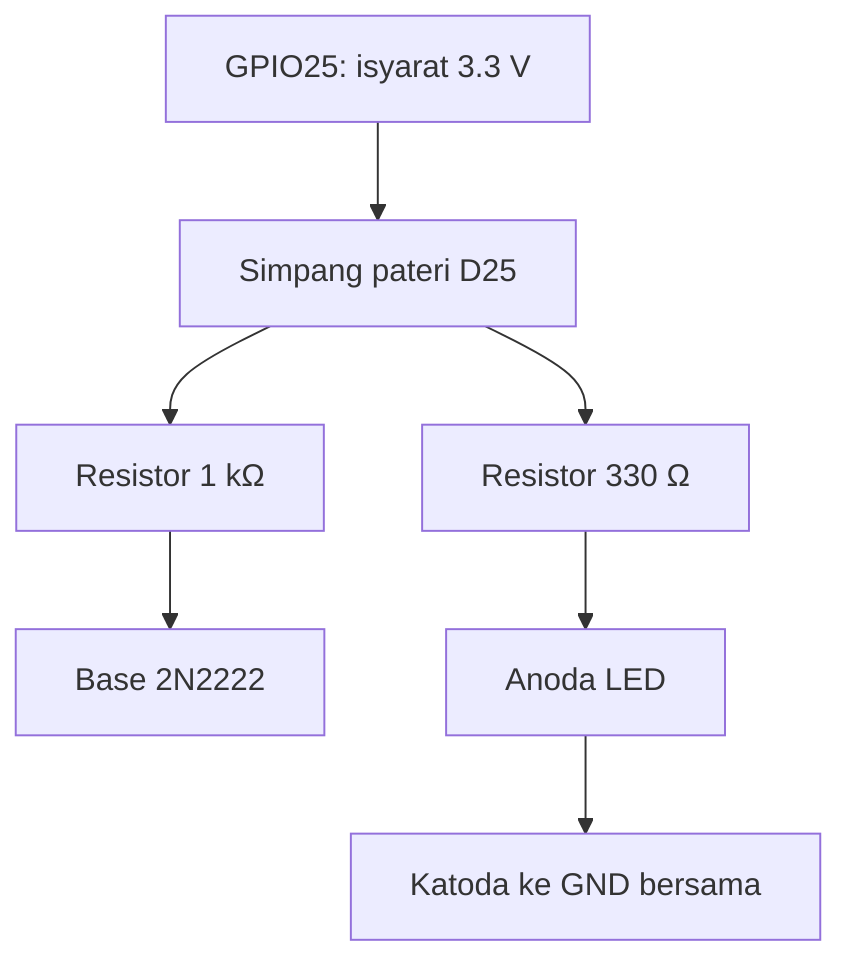
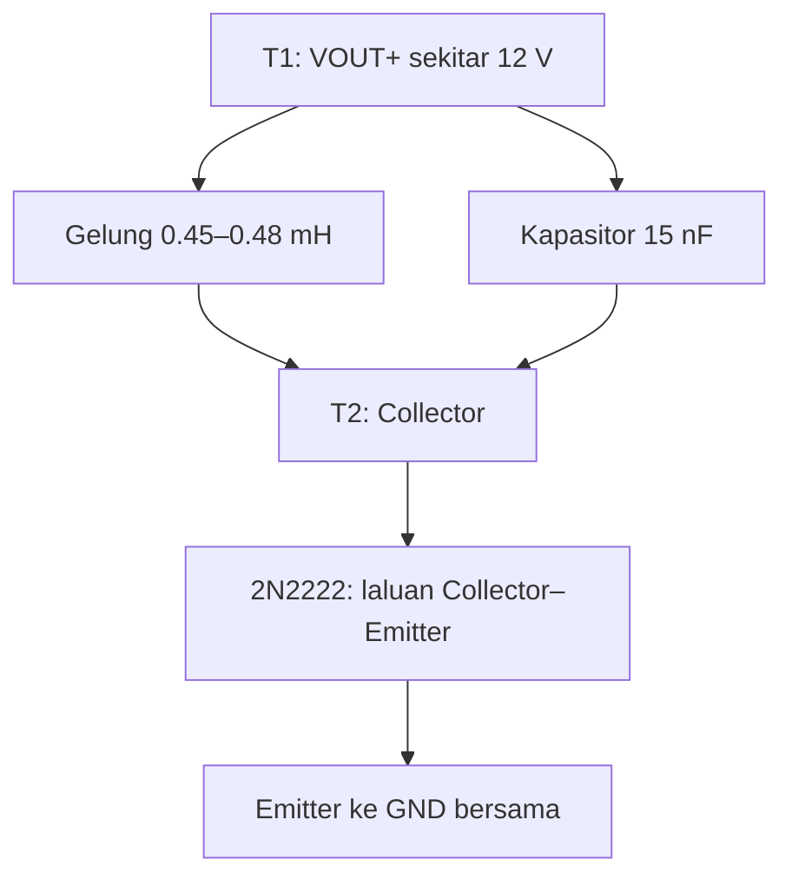

<p align="center">
  
</p>

<h1 align="center">MB6 TimeSync</h1>

<p align="center"><strong>G-SHOCK · MULTI BAND 6 · ESP32 · JJY 60 kHz</strong></p>

**Pemancar penyegerak masa 60 kHz berasaskan ESP32 untuk jam Casio yang menyokong penerimaan JJY.**

MB6 TimeSync mendapatkan masa melalui Wi-Fi dan NTP, kemudian menjana isyarat masa gaya JJY melalui antena rod ferrit. Projek ini menyediakan paparan OLED, kawalan melalui pelayar web dan pancaran berjadual untuk kegunaan jarak dekat.

Nama repositori: [`amundead/mb6-timesync-jjy`](https://github.com/amundead/mb6-timesync-jjy).

## Status projek — 19 Oktober 2026

**Ujian pengguna berjaya: jam menunjukkan L3 semasa penerimaan dan GET selepas selesai sync pada jarak sekitar 4 meter.** Pengguna turut melaporkan penerimaan dari bilik lain dengan pintu tertutup. Ini ialah hasil ujian pada pemasangan dan keadaan rumah tersebut; jangkauan untuk pemasangan lain belum disahkan.

Konfigurasi perkakasan terkini yang dilaporkan menggunakan **USB 5 V → MT3608 sekitar 12 V → litar LC selari**, dengan **transistor 2N2222**, **gelung 0.45–0.48 mH** dan **kapasitor 15 nF (153)**. Arus gelung, voltan puncak Collector dan ketahanan jangka panjang belum direkodkan.

### Firmware dalam repo

| Perkara | Status |
| --- | --- |
| Fail firmware | [`sketch_sep23a2.ino`](./sketch_sep23a2.ino), **v0.4.4** dengan deep sleep berjadual 04:10 MY |
| NTP utama | **SIRIM:** `ntp1.sirim.my` |
| NTP backup | **Cloudflare:** `time.cloudflare.com` |
| Fallback | Jika SIRIM tiada respons selepas **30 saat**, cuba Cloudflare selama 30 saat. Jika kedua-duanya gagal, tunggu **120 saat** sebelum mencuba semula dari SIRIM. |
| Paparan NTP | Msg/Web UI, OLED dan Serial menunjukkan pelayan yang sedang dicuba serta sumber sync terakhir |
| Tempoh dan jadual | Auto **8 minit**, Manual **10 minit**; 23:59, 01:59 dan 03:59 waktu Malaysia |
| Wi-Fi / sleep | Wi-Fi aktif ketika berjaga. **Deep sleep pada 04:10 MY**; sesi Manual aktif diselesaikan dahulu. Hidup semula melalui OFF/ON USB atau EN/reset; tiada wakeup automatik. |
| Pengesahan | Kandungan fail dan tetapan disemak; versi dalam commit ini belum di-compile atau dimuat naik ke board dalam sesi kemas kini ini. |

Firmware repo menggunakan **SIRIM sebagai pelayan utama** dan **Cloudflare sebagai backup**. MY Pool telah dikeluarkan daripada konfigurasi. Ia menggunakan **NTP/SNTP biasa, bukan NTS**. SSID dan kata laluan dalam versi GitHub ialah placeholder yang perlu diisi sebelum upload.

## Ciri utama

- Pembawa nominal **60 kHz** melalui GPIO25.
- Masa NTP melalui Wi-Fi, dengan **SIRIM utama / Cloudflare backup** dan paparan sumber NTP.
- OLED I2C **1.3 inci, 128 × 64**, menggunakan pemacu SH1106 dan pustaka Adafruit SH110X.
- Paparan masa Malaysia, status Wi-Fi/NTP, mod operasi, status TX, alamat IP dan jadual seterusnya.
- Ikon Wi-Fi, masa/NTP dan antena pada OLED.
- Web UI untuk pancaran manual, Auto ON/OFF, Stop TX dan permintaan NTP.
- Pancaran **manual 10 minit** dan **auto 8 minit** setiap sesi.
- Tetapan Auto disimpan melalui Preferences.
- Deep sleep harian pada **04:10 pagi Malaysia**, ditangguh sehingga Manual TX yang aktif tamat.
- Web UI dan Serial memaparkan waktu tidur seterusnya; tiada bangun automatik.
- Kawalan tambahan melalui Serial Monitor.
- TX ditahan apabila masa NTP belum sah atau sudah melebihi had usia firmware.

> `NTP:OK` bermaksud ESP32 menerima masa rangkaian. `TX:FRAME` bermaksud firmware sedang menjana bingkai pancaran. Kedua-duanya bukan pengesahan bahawa jam berjaya sync; semak keputusan penerimaan pada jam sendiri.

## Perkakasan

| Bil | Komponen | Spesifikasi / Kod | Fungsi & Titik Sambungan pada Papan Ekspansi |
| --- | --- | --- | --- |
| **1** | **Mikropengawal & Papan Ekspansi** | **ESP32 Dev Board (32-pin) + 32-pin Expansion Board**, mengikut pemasangan pengguna | Hab kawalan dan agihan kuasa/isyarat. D25 ialah isyarat logik 3.3 V. |
| **2** | **Modul Peningkat Voltan** | **MT3608 (Boost Converter)** | VIN+ → 5 V USB; VIN−/VOUT− → GND bersama; VOUT+ sekitar 12 V → litar antena. |
| **3** | **Transistor NPN** | **2N2222** | Suis elektronik *low-side* untuk kawalan isyarat 60 kHz. Sahkan kaki B/C/E mengikut datasheet unit sebenar. |
| **4** | **Perintang Transistor** | **1 kΩ** | Bersiri antara **simpang D25 → resistor 1 kΩ → Base** 2N2222. |
| **5** | **Perintang LED** | **330 Ω** | Bersiri antara **simpang D25 → resistor 330 Ω → anoda (+) LED**. |
| **6** | **LED Indikator** | **LED standard**, warna mengikut pilihan | Mengikuti aktiviti D25; kelipan yang kelihatan ialah sampul denyutan kod masa, bukan pembawa 60 kHz secara langsung. Katoda (−) → GND. |
| **7** | **Gegelung Antena (Induktor L1)** | **Rod ferrit 10 × 100 mm**, dawai enamel **AWG 26**; L1 sekitar **0.45–0.48 mH** | Teras pemancar medan magnet 60 kHz. Dipasang antara VOUT+ dan Collector. |
| **8** | **Kapasitor Tangki LC** | **15 nF**, kod **153** | Selari dengan gelung, antara VOUT+ dan Collector, untuk resonans ideal **hampir 60 kHz**. |
| **9** | **Paparan Status OLED** | **1.3 inci, IIC/I2C, 128 × 64, SH1106** | **VCC → 3.3 V; GND → GND bersama; SDA → D21; SCL/SCK → D22**. |

Peralatan pemasangan tambahan: donut board/perfboard berpad berasingan, terminal skru 2-pin, wayar penghubung dan penyambung yang sepadan. Kedua-dua resistor adalah komponen berasingan; cabang LED tidak menggantikan resistor Base.

Bekalan masuk sistem ialah **USB Micro 5 V pada papan ekspansi 32-pin**. Jumper VCC papan ditetapkan kepada **3.3 V untuk OLED**; sahkan menggunakan label dan ukuran voltan papan sebenar. MT3608 menaikkan voltan untuk **cabang antena sahaja** kepada sekitar 12 V; ESP32 kekal menggunakan USB 5 V dan OLED menggunakan 3.3 V. Pilih expansion board dengan bilangan pin, jarak soket dan susunan pin yang benar-benar sepadan dengan ESP32; jangan paksa board yang tidak sepadan ke soket.

**Catatan pinout:** jika transistor sebenar telah disahkan E–B–C apabila permukaan rata menghadap anda dan kaki ke bawah, gunakan susunan itu. Nama “2N2222” sahaja tidak menjamin urutan E–B–C bagi semua pengeluar atau varian.

ESP32 klasik menggunakan Wi-Fi **2.4 GHz**. Sambungkan kepada rangkaian 2.4 GHz atau SSID gabungan yang menyediakan jalur tersebut.

## Sambungan pin

### OLED

| Pin OLED | Sambungan |
| --- | --- |
| VCC | 3.3 V |
| GND | GND bersama |
| SDA | GPIO21 / D21, pin isyarat S |
| SCK / SCL | GPIO22 / D22, pin isyarat S |

Firmware mencuba alamat I2C `0x3C` dan `0x3D`. Jumper VCC expansion board kekal pada **3.3 V** untuk OLED. Input MT3608 diambil daripada **5 V tetap USB**, bukan baris VCC 3.3 V yang dipilih jumper.

**Model paparan telah disahkan pengguna:** OLED **SH1106 1.3 inci, 128 × 64**. Gunakan `Adafruit_SH1106G` daripada pustaka Adafruit SH110X seperti dalam firmware repo.

### 1. Sumber kuasa dan papan ekspansi

| Dari / tetapan | Sambungan |
| --- | --- |
| USB Micro 5 V | Port USB kuasa pada papan ekspansi 32-pin |
| Jumper papan | Rujukan VCC **3.3 V untuk OLED**, disahkan mengikut label dan ukuran papan |
| Terminal 5 V tetap | Bekalan input MT3608; berasingan daripada VCC yang dipilih jumper |

### 2. Modul peningkat voltan MT3608

| Pin MT3608 | Sambungan |
| --- | --- |
| VIN+ | Terminal 5 V tetap USB pada papan ekspansi |
| VIN− | GND bersama |
| VOUT+ | Sekitar **12 V**, titik **T1** litar LC |
| VOUT− | GND bersama |

### 3. Litar resonans LC selari

| Titik | Komponen yang bersambung |
| --- | --- |
| **T1: VOUT+ sekitar 12 V** | Hujung pertama gelung **dan** kaki pertama kapasitor 15 nF |
| **T2: Collector 2N2222** | Hujung kedua gelung **dan** kaki kedua kapasitor 15 nF |

Gelung dan kapasitor berkongsi **dua titik yang sama, T1 dan T2**. Kedua-duanya selari, dan tiada kaki kapasitor disambung terus ke GND.

### 4. Percabangan isyarat D25

Bina satu simpang pateri pada donut board yang menyatukan **wayar D25**, **kaki 1 resistor 1 kΩ** dan **kaki 1 resistor 330 Ω**.

| Cabang dari simpang D25 | Destinasi |
| --- | --- |
| Resistor **1 kΩ**, kaki 1 → kaki 2 | **Base (B)** 2N2222 sahaja |
| Resistor **330 Ω**, kaki 1 → kaki 2 | **Anoda (+)** LED indikator |



### 5. Transistor 2N2222 dan LED indikator

| Kaki | Sambungan |
| --- | --- |
| Base (B) | Kaki 2 resistor 1 kΩ |
| Collector (C) | **T2**, hujung kedua LC; **tiada sambungan terus ke GND** |
| Emitter (E) | Rel GND bersama |
| Anoda (+) LED | Kaki 2 resistor 330 Ω |
| Katoda (−) LED | Rel GND bersama |

Base, Collector dan Emitter ialah tiga titik elektrik berasingan. Sahkan pinout daripada nombor penuh dan pengeluar transistor sebenar; rajah ini merujuk kepada fungsi kaki, bukan urutan fizikalnya.



### 6. Rel ground bersama

Satukan titik berikut pada rujukan GND yang sama:

- **Katoda (−) LED indikator**.
- **Emitter (E) transistor 2N2222**.
- **Wayar GND ESP32**, contohnya pin GND berdekatan baris D25 pada papan ekspansi.
- **MT3608 VIN− dan VOUT−**.
- **OLED GND**.

Pada donut board, gunakan cantuman pateri atau wayar penghubung yang kemas. Semua pad berasingan sehingga disambungkan secara fizikal.

### 7. Paparan OLED 1.3 inci SH1106

| Pin OLED | Sambungan pada papan ekspansi |
| --- | --- |
| VCC | Pin V yang telah disahkan **3.3 V**, atau pin 3V3 tetap |
| GND | GND bersama |
| SDA | D21, pin isyarat S |
| SCL / SCK | D22, pin isyarat S |

LED menunjukkan aktiviti GPIO25, bukan ukuran kekuatan medan atau pengesahan GET pada jam. Pemancaran 60 kHz terlalu pantas untuk dilihat sebagai kelipan individu.

### Penalaan LC untuk 60 kHz

Frekuensi resonans ideal dikira menggunakan:

$$
f_0 = \frac{1}{2\pi\sqrt{LC}}
$$

| Induktans L | Kapasitor C | Frekuensi resonans ideal |
| --- | --- | --- |
| 0.45 mH | 15 nF | ≈61.3 kHz |
| 0.469 mH | 15 nF | ≈60.0 kHz |
| 0.48 mH | 15 nF | ≈59.3 kHz |

Oleh itu, 15 nF dengan 0.45–0.48 mH ialah **talaan hampir 60 kHz**, bukan bukti resonans tepat. Nilai sebenar turut dipengaruhi oleh toleransi kapasitor, ferrit, frekuensi pengukuran dan kapasitans parasit. Pembawa firmware tetap ditetapkan kepada 60 kHz; resonans antena mempengaruhi tindak balas litar terhadap pemacuan itu.

Bacaan terdahulu **5 m wayar = 1.53 mH** dan **15 m = 3.41 mH** merujuk kepada gelung ujian terdahulu. Nilai tersebut tidak digunakan untuk kiraan 15 nF di atas. Tiada nilai mH tunggal yang menjamin jarak 3 atau 4 meter.

### Had litar prototaip

Resistor 1 kΩ pada Base **tidak mengehadkan arus gelung secara langsung**. Gelung ialah beban induktif dan litar LC boleh menghasilkan voltan puncak yang melebihi bekalan 12 V. Kejayaan GET tidak mengesahkan voltan puncak, arus atau ketahanan pemacu.

Pengukuran arus, suhu transistor dan bentuk gelombang Collector masih diperlukan untuk menentukan had arus serta perlindungan yang sesuai pada 60 kHz. Rating voltan transistor dan kapasitor perlu disemak terhadap voltan puncak sebenar. Contohnya, datasheet **P2N2222A onsemi** menyenaraikan VCEO 40 V; angka itu bukan pengesahan model transistor yang dipasang atau rating operasi yang patut dicapai.

Gunakan satu sumber USB 5 V dalam setup ini. Ukur output MT3608 dengan multimeter sebelum menyambung cabang antena. Asingkan laluan sekitar 12 V daripada GPIO, pin kuasa ESP32 dan OLED. Cabut kuasa sebelum mengubah pendawaian atau membuat kerja pateri.

## Panduan pemasangan donut board

Panduan ini memindahkan sambungan prototaip ke perfboard. **Setiap pad donut berasingan**; lubang bersebelahan tidak bersambung secara automatik. Gunakan pateri untuk sambungan dekat dan wayar pendek berpenebat untuk sambungan jauh atau laluan yang bersilang.

Tetapkan dua terminal antena sebagai **T1 = VOUT+ MT3608 sekitar 12 V** dan **T2 = Collector**. Ini ialah label projek yang perlu ditanda pada papan, bukan nombor wajib pada terminal komersial. Semua kerja pematerian dibuat dengan USB dicabut.

### Fasa 1: Pematerian komponen pada donut board

1. **Pasang screw terminal block, klip biru.**

   Letakkan terminal 2-pin di tepi papan supaya skru mudah dicapai. Pastikan jarak pin sepadan dengan lubang sebelum memateri kedua-dua kaki. Tanda T1 dan T2.

2. **Pasang transistor 2N2222.**

   Kenal pasti Emitter (E), Base (B) dan Collector (C) mengikut datasheet unit sebenar. Letakkan transistor di kawasan tengah papan dengan ruang untuk sambungan. Susunan kiri E, tengah B, kanan C hanya digunakan apabila pinout itu telah disahkan.

3. **Pasang resistor 1 kΩ, laluan Base.**

   Letakkan kaki pertama resistor pada titik input D25. Sambungkan kaki kedua resistor ke **Base (B)** dengan pateri atau wayar pendek. Meletakkan kaki pada lubang bersebelahan sahaja tidak membuat sambungan.

4. **Pasang resistor 330 Ω dan LED indikator.**

   Letakkan kaki pertama resistor pada titik input D25. Sambungkan kaki kedua ke **anoda (+)** LED. Pada LED baharu, anoda biasanya kaki panjang; katoda biasanya kaki pendek dan sisi badan yang rata. Jika kaki sudah dipotong, sahkan polariti menggunakan datasheet atau mod diode multimeter.

5. **Bina percabangan isyarat D25.**

   Di sisi pateri, cantumkan **wayar input D25**, **kaki pertama resistor 1 kΩ** dan **kaki pertama resistor 330 Ω** pada satu titik elektrik yang sama. Jangan cantumkan titik ini terus ke Base tanpa resistor.

6. **Bina sambungan GND bersama.**

   Cantumkan **Emitter (E)** dan **wayar GND bersama ESP32/MT3608**. Cantumkan **katoda (−) LED** pada GND yang sama. Gunakan wayar penghubung jika titik-titik itu berjauhan; elakkan timbunan timah yang mudah menyentuh pad lain.

7. **Sambungkan Collector ke terminal antena.**

   Cantumkan **Collector (C)** ke **T2**. T2 menerima hujung kedua gelung dan kaki kedua kapasitor 15 nF.

8. **Bina titik bekalan antena dan sambungan kapasitor.**

   Cantumkan **T1** ke **VOUT+ MT3608 sekitar 12 V**. Pasang kapasitor **15 nF (153)** merentasi **T1 dan T2**, supaya selari dengan gelung. Kedua-dua kaki kapasitor tidak disambung terus ke rel GND. Pastikan T1 terasing daripada D25, Base dan laluan GND.

### Fasa 2: Sambungan antena dan perkakasan luar

9. **Pasang dua hujung gelung pada terminal block.**

   Bersihkan lapisan enamel pada kedua-dua hujung tembaga hingga sentuhan elektrik baik. Longgarkan skru, masukkan **hujung 1 ke T1 (VOUT+ sekitar 12 V)** dan **hujung 2 ke T2 (Collector)**, kemudian ketatkan. Pastikan wayar dikapit kukuh dan tiada tembaga terdedah yang bersentuh antara terminal.

10. **Tentukan panjang wayar penyambung.**

    Potong wayar mengikut kedudukan sebenar papan dan sediakan sedikit ruang untuk membengkok. Gunakan wayar solid-core untuk laluan pada donut board. Untuk header jantan extension board, gunakan penyambung female yang sesuai; jangan bergantung pada wayar kosong yang dicucuk longgar ke header.

### Fasa 3: Sambungan ESP32, extension board dan OLED

11. **Dudukkan ESP32 pada extension board.**

    Dengan kuasa diputuskan, sejajarkan semua pin dan orientasi board dengan soket. Tekan perlahan serta sekata. Pastikan tiada pin tersasar satu lubang atau terlipat.

12. **Sambungkan donut board dan MT3608.**

    | Wayar | Sambungan pada extension board |
    | --- | --- |
    | D25 | Pin **S** pada baris **D25**, lazimnya baris isyarat kuning |
    | GND | Pin **G** pada baris D25 atau mana-mana GND bersama, lazimnya baris hitam |
    | Bekalan antena T1 | MT3608 **VOUT+ sekitar 12 V** |
    | MT3608 VIN+ | Pin atau terminal **5 V tetap USB** |
    | MT3608 VIN−/VOUT− | GND bersama |

    Ikut label sebenar papan, bukan warna sahaja. Jumper VCC kekal **3.3 V** untuk OLED. Bekalan 5 V USB masuk ke MT3608, dan output sekitar 12 V pergi ke T1 antena sahaja.

13. **Pasang OLED I2C.**

    | Pin OLED | Pin extension board |
    | --- | --- |
    | VCC | VCC yang telah disahkan 3.3 V, atau pin 3V3 tetap |
    | GND | GND bersama |
    | SDA | D21, pin isyarat S |
    | SCL / SCK | D22, pin isyarat S |

    Jika D21/D22 tersedia di lebih daripada satu header, rujuk label pin isyarat dan sambungan papan. Jangan sambungkan SDA/SCL ke baris VCC atau GND.

### Fasa 4: Pemeriksaan dan pengujian

14. **Semak sambungan menggunakan multimeter.**

    Dengan USB dicabut, semak keterusan setiap laluan yang sepatutnya bersambung: T1 ke VOUT+ MT3608, T2 ke Collector dan GND ke Emitter/katoda LED. Pastikan kapasitor 15 nF merentasi T1/T2 dan tiada jambatan terus daripada T2 ke GND. Semak D25 ke resistor 1 kΩ dan hujung resistor ke Base. Semak juga cabang resistor 330 Ω ke anoda LED.

    Periksa juga tiada jambatan pateri terus antara laluan **12 V, 5 V, 3.3 V, GND dan D25**. Bacaan melalui resistor atau semikonduktor tidak semestinya bermaksud litar pintas; periksa laluan dan gunakan mod rintangan/diode apabila perlu. Ukur bekalan 3.3 V, 5 V dan output MT3608 sekitar 12 V menggunakan **mod voltan DC**, bukan mod keterusan pada litar berkuasa.

15. **Uji kuasa dan operasi.**

    Untuk operasi konfigurasi ini, gunakan **satu kabel USB Micro 5 V pada papan ekspansi**. Sahkan output MT3608 sekitar 12 V sebelum cabang antena disambung, kemudian putuskan kuasa sebelum melengkapkan sambungan. Semak OLED menyala, Wi-Fi tersambung dan NTP sah. Aktifkan **Manual TX**, tunggu minit penuh seterusnya dan perhatikan penunjuk TX serta LED.

    Kelipan yang kelihatan mengikuti **sampul denyutan kod masa**; mata tidak dapat melihat pembawa 60 kHz secara langsung. Untuk LED biru, nyalaan boleh lebih malap kerana voltan hadapannya. Semak keputusan sync pada jam sendiri. Jika transistor panas atau kuasa tidak stabil, hentikan ujian dan semak arus gelung serta litar pemacu.

## Perisian dan pemasangan

Gunakan Arduino IDE dengan:

- Pakej **esp32 by Espressif Systems**, siri **3.x** untuk firmware **v0.4.4** dalam repo.
- **Adafruit GFX Library**.
- **Adafruit SH110X**.
- **Adafruit BusIO**, jika diminta sebagai dependency.

`WiFi`, `WebServer`, `Wire` dan `Preferences` disediakan bersama pakej ESP32. Firmware ini menggunakan API LEDC siri 3.x; pakej ESP32 2.x tidak sesuai untuk kod tersebut.

1. Buka fail `.ino` firmware projek dalam Arduino IDE. Nama folder sketch perlu sama dengan nama fail `.ino` utamanya.
2. Pilih board ESP32 klasik yang sepadan, contohnya **ESP32 Dev Module**, serta port USB yang betul.
3. Masukkan SSID dan kata laluan Wi-Fi menggunakan nilai sendiri:

   ```cpp
   constexpr char WIFI_SSID[] = "NAMA_WIFI_2_4GHZ";
   constexpr char WIFI_PASSWORD[] = "KATA_LALUAN_WIFI";
   ```

4. Semak pin dan tetapan masa:

   ```cpp
   constexpr uint8_t TX_PIN = 25;
   constexpr uint8_t PIN_SDA = 21, PIN_SCL = 22;
   constexpr uint32_t CARRIER_HZ = 60000;
   constexpr int AUTO_TX_MINUTES = 8;
   constexpr int MANUAL_TX_MINUTES = 10;
   ```

5. Upload firmware melalui port USB pada **ESP32**. Port USB expansion board digunakan untuk kuasa dan tidak semestinya membawa data untuk flashing.
6. Buka Serial Monitor pada **115200 baud**.
7. Tunggu sambungan Wi-Fi dan NTP sebelum memulakan pancaran.

**Sebelum commit ke GitHub, gantikan SSID dan kata laluan sebenar dengan placeholder.** Jika credentials dipindahkan ke fail konfigurasi peribadi, pastikan fail itu dikecualikan daripada Git dan sediakan fail contoh tanpa rahsia.

## Jadual pancaran

Semua waktu jadual berikut ialah **waktu Malaysia, UTC+8**. Waktu tamat ialah penghujung tetingkap; sesi 23:59 melintasi tengah malam.

| Mod | Mula | Tamat | Tempoh |
| --- | --- | --- | --- |
| Auto | 23:59 | 00:07 hari berikutnya | 8 minit |
| Auto | 01:59 | 02:07 | 8 minit |
| Auto | 03:59 | 04:07 | 8 minit |
| Manual | Minit penuh seterusnya selepas arahan diterima | 10 minit selepas mula | 10 minit |

Dalam kod v0.4.4, jadual mula dinyatakan sebagai minit selepas tengah malam:

```cpp
constexpr int AUTO_START_MINUTES[] = {1439, 119, 239};
```

Pemasangan pertama bermula dengan Auto OFF. Boot berikutnya memulihkan tetapan Auto yang tersimpan. Selepas sesi manual tamat, firmware kembali kepada tetapan Auto/Stopped yang sedang dipilih.

Kejayaan penerimaan pada jam tidak membatalkan jadual berikutnya secara automatik kerana pemancar tidak menerima maklum balas daripada jam.

## Masa Malaysia dan JJY

| Bahagian | Zon masa |
| --- | --- |
| Masa OLED dan Web UI | Malaysia, UTC+8 |
| Jadual Auto | Malaysia, UTC+8 |
| Data masa dalam bingkai JJY firmware v0.4.4 | Jepun, JST / UTC+9 |

Tetapan Home City dan penerimaan radio bergantung pada model jam. Semak manual jam sebelum menukar bandar. Jika jam ditetapkan ke Tokyo, data JST biasa akan menghasilkan masa Tokyo, iaitu satu jam mendahului Malaysia.

Pengubahsuaian khas untuk menghantar masa Malaysia kepada jam yang ditetapkan ke Tokyo perlu dibuat pada pengekodan payload. Ia **bukan tetapan lalai** firmware v0.4.4 yang dirujuk dalam README ini.

## Penggunaan Web UI

1. Sambungkan telefon atau komputer ke rangkaian setempat yang sama dengan ESP32.
2. Buka alamat IP yang dipaparkan pada OLED, contohnya `http://192.168.0.180`. Alamat sebenar bergantung pada router.
3. Semak status Wi-Fi dan NTP.
4. Pilih kawalan yang diperlukan:

| Kawalan | Tindakan |
| --- | --- |
| Manual TX | Jadualkan pancaran 10 minit bermula pada minit penuh seterusnya |
| Auto ON | Aktifkan jadual pancaran automatik |
| Auto OFF | Nyahaktifkan jadual auto; sesi manual aktif boleh diteruskan |
| Stop TX | Batalkan sesi manual dan simpan Auto OFF |
| Sync NTP | Minta masa baharu; TX menunggu masa yang sah |

Web UI ini digunakan pada rangkaian setempat; elakkan mendedahkannya terus kepada internet.

## Arahan Serial

| Arahan | Fungsi |
| --- | --- |
| `t` | Mulakan sesi manual |
| `a` | Auto ON |
| `o` | Auto OFF |
| `x` | Stop TX dan Auto OFF |
| `s` | Paparkan status |
| `n` | Minta sync NTP |
| `?` | Paparkan bantuan |

## Paparan status

| Status | Maksud |
| --- | --- |
| `WiFi:OK` | ESP32 tersambung kepada Wi-Fi |
| `NTP:OK` | Masa NTP masih memenuhi had usia firmware |
| `TX:FRAME` | Firmware sedang menjana bingkai masa |
| `TX:IDLE` | Tiada bingkai sedang dipancarkan |
| `TX:ERROR` | Terdapat masalah pengawalan output |
| `Next` | Jadual mula auto seterusnya dalam waktu Malaysia |
| `Auto sleep (04:10 MY)` / `shutdown` | Tarikh/waktu tidur seterusnya, atau status menunggu sesi Manual |

Firmware v0.4.4 meminta NTP setiap satu jam dan menggunakan had usia masa dua jam. Paparan status TX datang daripada keadaan firmware, bukan sensor RF atau pengukuran antena.

## Ujian dengan jam

1. Semak pendawaian dan tunggu `WiFi:OK` serta `NTP:OK`.
2. Letakkan jam dekat dengan gelung untuk ujian awal.
3. Aktifkan Manual TX dan tunggu bingkai mula dipancarkan.
4. Mulakan penerimaan radio manual pada jam mengikut panduan model tersebut.
5. Biarkan jam tanpa bergerak sehingga penerimaan selesai.
6. Semak penunjuk kejayaan seperti `GET`, tarikh penerimaan terakhir dan masa pada jam.
7. Uji jarak secara berperingkat dengan orientasi gelung dan jam yang sama.

### Rekod ujian lapangan

| Tarikh | Pemerhatian pengguna | Skop keputusan |
| --- | --- | --- |
| Ujian prototaip terdahulu | Dua jam dilaporkan berjaya sync | Membuktikan penerimaan pada jam yang diuji ketika itu |
| **15 Oktober 2026** | Penunjuk penerimaan **L3**, diikuti status **GET**, pada jarak sekitar **4 meter** | Kejayaan sync yang diperhatikan pada jam dalam pemasangan pengguna |
| **15 Oktober 2026** | Jam berada di **bilik lain dengan pintu tertutup** dan masih berjaya sync | Pemerhatian persekitaran rumah pengguna; bukan ujian semua jenis dinding atau pintu |

Sasaran asal sekitar 3 meter telah dilepasi dalam ujian yang dilaporkan. L3 ialah penunjuk pada jam, bukan bacaan medan magnet yang ditentukur. Pemancar tidak menerima mesej GET daripada jam secara automatik.

Rekod ini berdasarkan laporan pengguna. Model jam untuk ujian terkini, orientasi, arus antena dan voltan puncak Collector belum dicatat. Jangkauan sebenar bergantung pada antena, pemacu, penerima dan gangguan setempat. Pantau auto sync beberapa malam pada kedudukan yang sama untuk menilai konsistensi.

## Penyelesaian masalah

| Masalah | Semakan |
| --- | --- |
| OLED kosong atau paparan rosak | Semak 3.3 V, GND, SDA/SCL, alamat I2C dan pemacu SH1106; kosongkan buffer dengan `oled.clearDisplay()` sebelum melukis skrin |
| Wi-Fi tidak tersambung | Semak SSID, kata laluan dan ketersediaan jalur 2.4 GHz |
| NTP menunggu / stale | Semak internet, DNS dan UDP port 123; pastikan pelayan yang disemak sepadan dengan versi firmware yang dimuat naik |
| Manual TX ditolak | Semak masa NTP serta status perkakasan/output |
| TX IDLE ketika Auto ON | Semak waktu Malaysia dan tetingkap jadual; Auto ON tidak bermaksud TX berterusan |
| Jam menerima lemah atau gagal | Dekatkan jam, ubah orientasi dan semak sambungan gelung, tala LC, output MT3608 serta pinout transistor |
| Web UI tidak boleh dibuka | Semak IP semasa, rangkaian setempat dan pengasingan peranti pada guest Wi-Fi |
| Transistor menjadi panas | Hentikan TX dan putuskan kuasa; ukur arus gelung dan semak reka bentuk pemacu |

## Kuasa dan deep sleep pada 04:10 pagi

Firmware **v0.4.4** mengekalkan Wi-Fi aktif semasa berjaga dengan `WiFi.setSleep(false)`. Selepas sesi auto terakhir **03:59–04:07**, ESP32 masuk **deep sleep pada 04:10 waktu Malaysia**.

| Keadaan | Tindakan |
| --- | --- |
| 04:10 tiba, tiada Manual TX aktif | Hentikan TX, pegang GPIO25 LOW, padam OLED dan matikan Wi-Fi, kemudian deep sleep |
| Manual TX masih aktif atau menunggu minit mula pada 04:10 | Tunggu sesi Manual tamat; kemudian terus deep sleep |
| Stop membatalkan Manual selepas waktu tidur telah tiba | Deep sleep selepas pembatalan diproses |
| Auto OFF / STOPPED tanpa sesi Manual | Masih tidur pada 04:10; pengecualian hanya untuk sesi Manual aktif, bukan Auto OFF sepanjang hari |
| Boot dan NTP pertama sebelum 04:10 | Jadualkan tidur pada 04:10 yang akan datang |
| OFF/ON USB atau EN/reset, dengan NTP pertama pada/selepas 04:10 | Kekal berjaga; jadualkan tidur pada 04:10 hari berikutnya |
| Belum pernah mendapat masa NTP sah sejak boot | Kekal berjaga, menunggu masa sah untuk menetapkan jadual |
| Wi-Fi/NTP terputus selepas jadual telah ditetapkan | Pemasa monotonik meneruskan jadual; NTP sah seterusnya membetulkan waktu sasaran sebelum ia tiba |

Tiada timer bangun, bangun GPIO atau wakeup berjadual diaktifkan. **Web UI tidak boleh dicapai semasa deep sleep**. Untuk hidupkan semula, OFF suis/cabut USB sehingga kuasa benar-benar padam, kemudian ON semula; butang EN/reset juga boleh memulakan boot baharu. Boot memulihkan tetapan Auto daripada Preferences. Sesi Manual tidak disambung selepas reboot.

**Deep sleep tidak memutuskan bekalan USB secara fizikal.** MT3608, regulator, antara muka USB dan LED kuasa papan masih boleh menerima kuasa. GPIO25 menggunakan RTC hold LOW supaya transistor tidak dipacu ketika tidur. Firmware tidak mengesahkan bekalan 12 V telah terputus. Untuk memadamkan seluruh perkakasan, kuasa USB perlu diputuskan atau perkakasan pemutus kuasa ditambah.

Waktu sasaran ditetapkan selepas NTP pertama yang sah. Contohnya, hidupkan peranti pada 20:00 untuk tidur pada 04:10 esok; hidupkan semula pada 09:00 untuk kekal berjaga sehingga 04:10 hari berikutnya. Pengecualian Manual meliputi sesi 10 minit sahaja; setelah sesi itu tamat, jadual tidur yang telah tiba diteruskan tanpa tambahan masa.

Sebelum tidur, firmware menunggu callback TX mengesahkan output telah dimatikan sebelum menghentikan timer dan memindahkan GPIO25 kepada RTC hold. Jika persediaan tidur gagal, firmware kekal berjaga dengan TX disekat dan memaparkan ralat; ia tidak meneruskan tidur dengan konfigurasi output yang belum disahkan.

Pengesahan versi ini merangkumi ujian host bagi logik jadual dan urutan persediaan tidur serta semakan Web UI. **Compile ESP32 penuh dan ujian pada board belum dilakukan** kerana toolchain ESP32 tidak tersedia dalam persekitaran kemas kini ini.

## Skop dan pembangunan seterusnya

Projek ini menjana isyarat **gaya JJY pada 60 kHz**. Nama MB6 merujuk kepada sasaran jam; firmware ini tidak menyediakan semua protokol yang disokong Casio Multi Band 6.

Firmware rujukan belum melaksanakan pengendalian leap second penuh dan bingkai khas JJY pada minit 15/45. Oleh itu, ia merupakan simulator prototaip dan bukan pelaksanaan lengkap stesen JJY.

Perkara yang boleh dibangunkan seterusnya:

- Pengukuran arus gelung dan voltan Collector, serta pengesahan perlindungan lonjakan.
- Pengesahan tala LC pada 60 kHz dalam pemasangan sebenar, termasuk toleransi kapasitor dan kesan ferrit.
- Log sesi pancaran dan catatan kejayaan jam yang dimasukkan oleh pengguna.
- Pengesahan deep sleep 04:10 pada perkakasan sebenar, termasuk GPIO25 LOW, OLED padam dan OFF/ON USB.
- Modem sleep semasa berjaga belum diaktifkan.
- Catatan konsistensi auto sync, konfigurasi akhir antena, dan pemasangan casing dengan sambungan yang kemas.

## Rujukan

- [ESP32 sleep modes — Espressif](https://docs.espressif.com/projects/esp-idf/en/stable/esp32/api-reference/system/sleep_modes.html)
- [GPIO dan RTC hold — Espressif](https://docs.espressif.com/projects/esp-idf/en/stable/esp32/api-reference/peripherals/gpio.html)

- [ESP32 datasheet — Espressif](https://www.espressif.com/sites/default/files/documentation/esp32_datasheet_en.pdf)
- [Arduino ESP32: perubahan API 2.x ke 3.x](https://docs.espressif.com/projects/arduino-esp32/en/latest/migration_guides/2.x_to_3.0.html)
- [Adafruit SH110X](https://github.com/adafruit/Adafruit_SH110x)
- [Resonans LC dan kesan pengukuran — Coilcraft](https://www.coilcraft.com/en-us/resources/application-notes/measuring-self-resonant-frequency/)
- [Cloudflare Time Services: NTP](https://developers.cloudflare.com/time-services/ntp/)
- [P2N2222A datasheet — contoh pinout mengikut nombor komponen](https://www.onsemi.com/pdf/datasheet/p2n2222a-d.pdf)
- [Pemacuan beban induktif — Texas Instruments](https://www.ti.com/video/6018730150001)
- [JJY Signal Simulator — inspirasi projek](https://olafkrawczyk.com/journal/jjy-signal-simulator/)

## Lesen

Lesen repositori belum ditetapkan. Tambahkan fail `LICENSE` apabila pemilik projek memilih lesen yang sesuai. Dependency pihak ketiga tertakluk pada lesen masing-masing.

## Fail logo untuk GitHub

| Fail | Lokasi dalam repositori |
| --- | --- |
| README ini | `README.md` di root repo |
| Logo / banner projek | `mb6-timesync-banner.png` di root repo, bersebelahan README |

Letakkan kedua-duanya dengan struktur tersebut supaya laluan `./mb6-timesync-banner.png` dalam README terus merujuk kepada banner yang betul. Banner ini ialah identiti grafik projek DIY MB6 TimeSync; nama G-SHOCK dan MULTI BAND 6 merujuk kepada keluarga jam sasaran.
