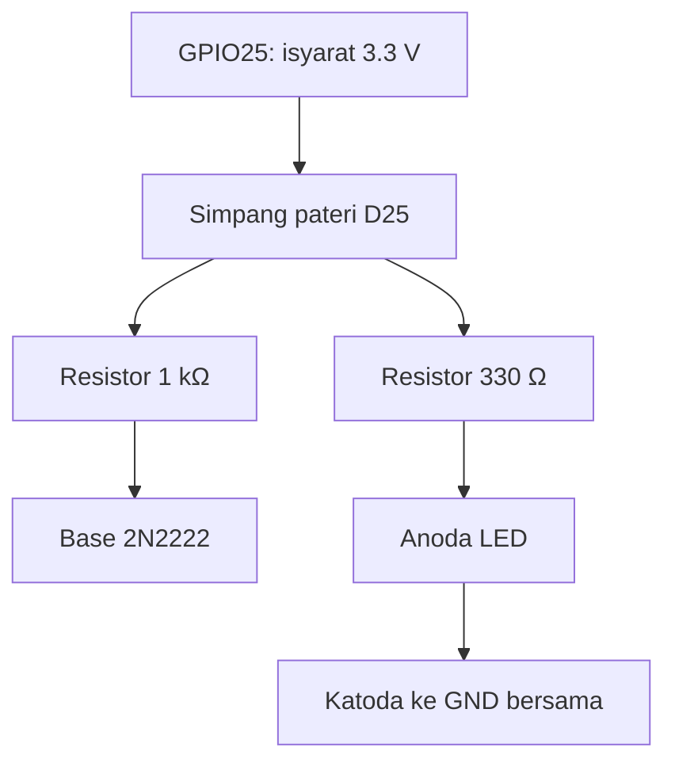
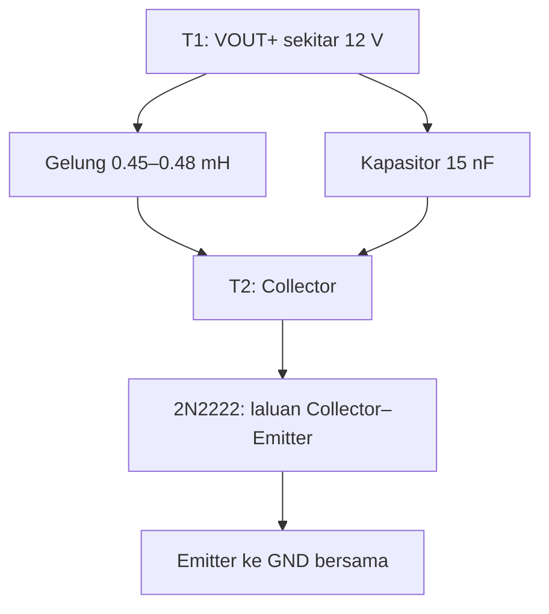

<p align="center">
  
</p>

<h1 align="center">MB6 TimeSync</h1>

<p align="center"><strong>G-SHOCK · MULTI BAND 6 · ESP32 · JJY 60 kHz</strong></p>

**Pemancar penyegerak masa 60 kHz berasaskan ESP32 untuk jam Casio yang menyokong penerimaan JJY.**

MB6 TimeSync mendapatkan masa melalui Wi-Fi dan NTP, kemudian menjana isyarat masa gaya JJY melalui antena rod ferrit. Projek ini menyediakan paparan OLED, kawalan melalui pelayar web dan pancaran berjadual untuk kegunaan jarak dekat.

Nama repositori: [`amundead/mb6-timesync-jjy`](https://github.com/amundead/mb6-timesync-jjy).

## Status firmware — v0.4.7, 2 November 2026

Branch **[`0.4.7`](https://github.com/amundead/mb6-timesync-jjy/tree/0.4.7)** dibina daripada `0.4.6`. Web UI kini mempunyai checkbox **Auto Deep Sleep 04:10 MY** dan **Auto Wakeup 23:40 MY**, dengan simpanan tetapan yang berbeza mengikut fungsi.

### Perubahan v0.4.7

- **Auto Deep Sleep** hanya berjalan apabila ditanda. Tetapan disimpan dalam Preferences/NVS, key `deepSleep`, namespace `mb6bypass`. Default pemasangan baharu **dan upgrade daripada 0.4.6 ialah OFF** sehingga pengguna menandanya.
- **Auto Wakeup** menggunakan timer ESP32 untuk 23:40 waktu Malaysia yang akan datang. Tetapan disimpan dalam RTC sahaja, bukan NVS. Ia kekal merentas bangun timer deep sleep, tetapi kembali **OFF selepas bekalan putus, brownout, EN/reset atau reboot biasa**. Pengguna boleh menandanya semula selepas peranti hidup.
- Kedua-dua checkbox berasingan. Jika Auto Deep Sleep OFF, peranti kekal berjaga dan timer wakeup tidak digunakan. Jika Auto Deep Sleep ON tetapi Auto Wakeup OFF, peranti tidur tanpa timer bangun.
- Manual TX yang aktif masih ditunggu hingga tamat. Mematikan Auto Deep Sleep membatalkan jadual/pending sleep. Mengaktifkannya pada/selepas 04:10 menjadualkan 04:10 hari berikutnya.
- Web UI/API/Serial status JSON menunjukkan kedua-dua pilihan, status simpanan sleep dan sasaran bangun. Kawalan menggunakan POST dengan token/host validation dan perlindungan terhadap polling lama seperti kawalan jadual.
- Sebelum tidur: TX dibisukan, GPIO25 dipegang LOW dan sumber wakeup lama dinyahaktifkan. Timer 23:40 hanya diaktifkan jika dipilih. Ralat mute, RTC hold, timer stop atau wake timer menghalang masuk deep sleep dan menyekat TX.
- Selepas timer bangun, ESP32 boot semula, menyambung Wi-Fi, mendapatkan NTP dan memulihkan pilihan Auto TX/slot. Wakeup tidak mengaktifkan Auto TX yang sebelumnya OFF; tiada TX sebelum masa NTP sah.
- **Kemas kini 3 November 2026:** PWM 8-bit kini menggunakan **duty TX 128/256 = 50% tepat**, menggantikan 127 (~49.61%). Idle kekal 0 dan pembawa nominal 60 kHz. OOK, jadual, checkbox sleep/wakeup dan susunan NTP kekal.

### Sejarah versi

#### v0.4.4 — deep sleep berjadual dan susunan NTP

- Deep sleep pada **04:10 waktu Malaysia**, selepas sesi Manual yang aktif tamat.
- Sebelum tidur, TX dibisukan dan **GPIO25 dipegang LOW**; OLED dipadamkan dan Wi-Fi dimatikan. Bekalan USB/MT3608 tidak diputuskan secara fizikal.
- Tiada wakeup automatik. OFF/ON USB atau EN/reset diperlukan untuk boot semula. Boot dengan NTP pertama pada/selepas 04:10 menjadualkan tidur pada 04:10 hari berikutnya.
- Pada keadaan branch `0.4.4` yang dirujuk, **SIRIM `ntp1.sirim.my`** ialah pelayan utama dan **Cloudflare `time.cloudflare.com`** backup. Timeout 30 saat setiap pelayan; cuba semula selepas 120 saat jika kedua-duanya gagal.
- Web UI, OLED dan Serial menunjukkan pelayan yang sedang dicuba serta sumber sync terakhir. Auto 8 minit dan Manual 10 minit diteruskan.

#### v0.4.5 — pilihan waktu sync dalam Web UI

- Pilihan berasingan untuk **23:59**, **01:59** dan **03:59**, semuanya waktu Malaysia.
- Pilihan waktu dan status Auto disimpan bersama dalam Preferences dan dipulihkan selepas reboot atau OFF/ON USB.
- Pilihan kosong menyekat Auto pada firmware juga, termasuk arahan Serial `a` dan permintaan API. Manual TX masih tersedia apabila masa NTP dan output sah.
- Paparan **Next auto slot**, OLED dan keputusan memulakan TX menggunakan waktu yang dipilih sahaja.
- Upgrade daripada `0.4.4` memilih ketiga-tiga waktu secara lalai dan memulihkan status Auto lama. Pemasangan baharu bermula dengan Auto OFF.
- Menyahpilih waktu yang sedang memancar menghentikan pancaran Auto itu. Sesi Manual yang aktif kekal dijadualkan hingga tamat; penyimpanan tetapan boleh menjeda bingkai semasa sementara output dibisukan.
- Deep sleep **04:10 MY**, Auto **8 minit**, Manual **10 minit**, serta SIRIM utama / Cloudflare backup diteruskan daripada `0.4.4`.

#### v0.4.6 — PWM LEDC 8-bit

- `setup()`: `ledcAttachChannel(TX_PIN,CARRIER_HZ,8,0)` menggantikan resolusi 1-bit.
- `onEnvelope()`: `ledcWrite(TX_PIN,out.gate?127:0)` menggantikan duty TX 1 pada resolusi lama. Semua laluan mute, Stop dan tidur mengekalkan duty 0.
- Dalam PWM 8-bit, satu tempoh mempunyai **256 langkah**. Duty **127/256 = 49.609375%**, hampir 50%; nilai tepat 50% ialah 128. Profil v0.4.6 menggunakan nilai **127**.
- PWM lama 1-bit dengan duty 1 sudah menghasilkan 50% dalam Arduino ESP32 3.3.12. Perubahan ini menambah resolusi dan mengubah duty sedikit; ia bukan bukti bahawa PWM lama rosak atau jarak pancaran akan meningkat.
- Versi pada komen firmware, Web UI dan Serial ditukar kepada v0.4.6. Komen pendawaian dikemas kini kepada TC4420 + IRFZ44N dan kapasitor semasa.
- Pilihan waktu sync, penyimpanan Preferences, tempoh Auto/Manual, NTP, OOK dan deep sleep diteruskan daripada v0.4.5.


### Rekod perkakasan terdahulu

**Ujian pengguna berjaya: jam menunjukkan L3 semasa penerimaan dan GET selepas selesai sync pada jarak sekitar 4 meter.** Pengguna turut melaporkan penerimaan dari bilik lain dengan pintu tertutup. Ini ialah hasil ujian pada pemasangan dan keadaan rumah tersebut; jangkauan untuk pemasangan lain belum disahkan.

Konfigurasi perkakasan terdahulu menggunakan **USB 5 V → MT3608 sekitar 12 V → litar LC selari**, dengan **transistor 2N2222**, **gelung 0.45–0.48 mH** dan **kapasitor 15 nF (153)**. Arus gelung, voltan puncak Collector dan ketahanan jangka panjang belum direkodkan.

### Firmware dalam repo

| Perkara | Status |
| --- | --- |
| Fail firmware | [`sketch_sep23a2.ino`](./sketch_sep23a2.ino), **v0.4.7**, pilihan waktu sync serta checkbox sleep/wakeup |
| NTP utama | **SIRIM:** `ntp1.sirim.my` |
| NTP backup | **Cloudflare:** `time.cloudflare.com` |
| Fallback | Jika SIRIM tiada respons selepas **30 saat**, cuba Cloudflare selama 30 saat. Jika kedua-duanya gagal, tunggu **120 saat** sebelum mencuba semula dari SIRIM. |
| Paparan NTP | Msg/Web UI, OLED dan Serial menunjukkan pelayan yang sedang dicuba serta sumber sync terakhir |
| Tempoh dan jadual | Auto **8 minit**, Manual **10 minit**; pilih 23:59, 01:59 dan/atau 03:59 melalui checkbox Web UI |
| Wi-Fi / sleep | Wi-Fi aktif ketika berjaga. **Auto Deep Sleep 04:10 MY** hanya jika ditanda; Manual aktif ditunggu. **Auto Wakeup 23:40 MY** pilihan, kembali OFF selepas bekalan putus/reset. |
| Pengesahan | Ujian host jadual, sleep/wakeup dan Web UI lulus. Compile penuh ESP32 Dev Module lulus; ujian board/penerimaan jam belum dilakukan. |

Firmware repo menggunakan **SIRIM sebagai pelayan utama** dan **Cloudflare sebagai backup**. MY Pool telah dikeluarkan daripada konfigurasi. Ia menggunakan **NTP/SNTP biasa, bukan NTS**. SSID dan kata laluan dalam versi GitHub ialah placeholder yang perlu diisi sebelum upload.

## Ciri utama

- Pembawa nominal **60 kHz** melalui GPIO25.
- Masa NTP melalui Wi-Fi, dengan **SIRIM utama / Cloudflare backup** dan paparan sumber NTP.
- OLED I2C **1.3 inci, 128 × 64**, menggunakan pemacu SH1106 dan pustaka Adafruit SH110X.
- Paparan masa Malaysia, status Wi-Fi/NTP, mod operasi, status TX, alamat IP dan jadual seterusnya.
- Ikon Wi-Fi, masa/NTP dan antena pada OLED.
- Web UI untuk pancaran manual, Auto ON/OFF, Stop TX dan permintaan NTP.
- Pancaran **manual 10 minit** dan **auto 8 minit** setiap sesi.
- Checkbox setiap waktu sync; tetapan Auto dan pilihan waktu disimpan melalui Preferences.
- Checkbox Auto Deep Sleep **04:10 pagi Malaysia**, ditangguh sehingga Manual TX aktif tamat; tetapan disimpan dalam NVS.
- Checkbox Auto Wakeup **23:40 Malaysia**, disimpan dalam RTC semasa deep sleep; OFF selepas bekalan putus atau reset biasa.
- Web UI dan status JSON/Serial memaparkan waktu tidur dan bangun seterusnya.
- Kawalan tambahan melalui Serial Monitor.
- TX ditahan apabila masa NTP belum sah atau sudah melebihi had usia firmware.

> `NTP:OK` bermaksud ESP32 menerima masa rangkaian. `TX:FRAME` bermaksud firmware sedang menjana bingkai pancaran. Kedua-duanya bukan pengesahan bahawa jam berjaya sync; semak keputusan penerimaan pada jam sendiri.

## Perkakasan semasa — TC4420 + IRFZ44N

| Bahagian | Sambungan / nilai |
| --- | --- |
| Input TC4420 | GPIO25 → 1 kΩ → Pin 2 INPUT; INPUT → 10 kΩ → Common GND |
| Bekalan TC4420 | Pin 1 dan 8 → sekitar 12 V; Pin 4 dan 5 → Common GND |
| Output TC4420 | Pin 6 dan 7 disatukan → Gate IRFZ44N; Pin 3 NC tidak disambung |
| IRFZ44N | Source → GND; Drain → T2. Semak datasheet model sebenar; jangan keliru dengan IRLZ44N. |
| LC selari | Gelung sekitar **0.47 mH** bersama **153 (15 nF) + 101 (100 pF) + 221 (220 pF)**, semuanya antara **T1 (+12 V)** dan **T2 (Drain)** |
| Jumlah kapasitor LC | **15.32 nF nominal**; resonans LC ideal sekitar **59.31 kHz** sebelum kesan parasit/toleransi. Pembawa firmware kekal nominal 60 kHz. |
| Bypass TC4420 | **333 (33 nF) + 105 (1 µF)** selari antara VDD dan GND, dekat cip; bukan sebahagian daripada kapasitor LC |
| LED pilihan | GPIO25 → 220 Ω → Anod; Katod → Common GND |
| OLED | SH1106, 3.3 V; SDA21 dan SCL22 |

TC4420 tidak menyongsangkan input: GPIO25 LOW sepatutnya mematikan MOSFET. Pertukaran kepada pemacu ini dilaporkan menurunkan jarak daripada sekitar 7 m pada 2N2222 kepada sekitar 1.5 m; perubahan PWM v0.4.6 **belum diuji untuk membuktikan pemulihan jarak**. Firmware tiada sensor arus, suhu, medan antena atau voltan puncak Drain.

## Perkakasan lama — 2N2222

**Bahagian perkakasan dan langkah pemasangan di bawah ialah rekod konfigurasi 2N2222 terdahulu, sehingga tajuk “Perisian dan pemasangan”. Untuk TC4420 + IRFZ44N, gunakan jadual perkakasan semasa di atas.**

| Bil | Komponen | Spesifikasi / Kod | Fungsi & Titik Sambungan pada Papan Ekspansi |
| --- | --- | --- | --- |
| **1** | **Mikropengawal & Papan Ekspansi** | **ESP32 Dev Board (32-pin) + 32-pin Expansion Board**, mengikut pemasangan pengguna | Hab kawalan dan agihan kuasa/isyarat. D25 ialah isyarat logik 3.3 V. |
| **2** | **Modul Peningkat Voltan** | **MT3608 (Boost Converter)** | VIN+ → 5 V USB; VIN−/VOUT− → GND bersama; VOUT+ sekitar 12 V → litar antena. |
| **3** | **Transistor NPN** | **2N2222** | Suis elektronik *low-side* untuk kawalan isyarat 60 kHz. Sahkan kaki B/C/E mengikut datasheet unit sebenar. |
| **4** | **Perintang Transistor** | **1 kΩ** | Bersiri antara **simpang D25 → resistor 1 kΩ → Base** 2N2222. |
| **5** | **Perintang LED** | **330 Ω** | Bersiri antara **simpang D25 → resistor 330 Ω → anoda (+) LED**. |
| **6** | **LED Indikator** | **LED standard**, warna mengikut pilihan | Mengikuti aktiviti D25; kelipan yang kelihatan ialah sampul denyutan kod masa, bukan pembawa 60 kHz secara langsung. Katoda (−) → GND. |
| **7** | **Gegelung Antena (Induktor L1)** | **Rod ferrit 10 × 100 mm**, dawai enamel **AWG 26**; L1 sekitar **0.45–0.48 mH** | Teras pemancar medan magnet 60 kHz. Dipasang antara VOUT+ dan Collector. |
| **8** | **Kapasitor Tangki LC** | **15 nF**, kod **153** | Selari dengan gelung, antara VOUT+ dan Collector, untuk resonans ideal **hampir 60 kHz**. |
| **9** | **Paparan Status OLED** | **1.3 inci, IIC/I2C, 128 × 64, SH1106** | **VCC → 3.3 V; GND → GND bersama; SDA → D21; SCL/SCK → D22**. |

Peralatan pemasangan tambahan: donut board/perfboard berpad berasingan, terminal skru 2-pin, wayar penghubung dan penyambung yang sepadan. Kedua-dua resistor adalah komponen berasingan; cabang LED tidak menggantikan resistor Base.

Bekalan masuk sistem ialah **USB Micro 5 V pada papan ekspansi 32-pin**. Jumper VCC papan ditetapkan kepada **3.3 V untuk OLED**; sahkan menggunakan label dan ukuran voltan papan sebenar. MT3608 menaikkan voltan untuk **cabang antena sahaja** kepada sekitar 12 V; ESP32 kekal menggunakan USB 5 V dan OLED menggunakan 3.3 V. Pilih expansion board dengan bilangan pin, jarak soket dan susunan pin yang benar-benar sepadan dengan ESP32; jangan paksa board yang tidak sepadan ke soket.

**Catatan pinout:** jika transistor sebenar telah disahkan E–B–C apabila permukaan rata menghadap anda dan kaki ke bawah, gunakan susunan itu. Nama “2N2222” sahaja tidak menjamin urutan E–B–C bagi semua pengeluar atau varian.

ESP32 klasik menggunakan Wi-Fi **2.4 GHz**. Sambungkan kepada rangkaian 2.4 GHz atau SSID gabungan yang menyediakan jalur tersebut.

## Sambungan pin

### OLED

| Pin OLED | Sambungan |
| --- | --- |
| VCC | 3.3 V |
| GND | GND bersama |
| SDA | GPIO21 / D21, pin isyarat S |
| SCK / SCL | GPIO22 / D22, pin isyarat S |

Firmware mencuba alamat I2C `0x3C` dan `0x3D`. Jumper VCC expansion board kekal pada **3.3 V** untuk OLED. Input MT3608 diambil daripada **5 V tetap USB**, bukan baris VCC 3.3 V yang dipilih jumper.

**Model paparan telah disahkan pengguna:** OLED **SH1106 1.3 inci, 128 × 64**. Gunakan `Adafruit_SH1106G` daripada pustaka Adafruit SH110X seperti dalam firmware repo.

### 1. Sumber kuasa dan papan ekspansi

| Dari / tetapan | Sambungan |
| --- | --- |
| USB Micro 5 V | Port USB kuasa pada papan ekspansi 32-pin |
| Jumper papan | Rujukan VCC **3.3 V untuk OLED**, disahkan mengikut label dan ukuran papan |
| Terminal 5 V tetap | Bekalan input MT3608; berasingan daripada VCC yang dipilih jumper |

### 2. Modul peningkat voltan MT3608

| Pin MT3608 | Sambungan |
| --- | --- |
| VIN+ | Terminal 5 V tetap USB pada papan ekspansi |
| VIN− | GND bersama |
| VOUT+ | Sekitar **12 V**, titik **T1** litar LC |
| VOUT− | GND bersama |

### 3. Litar resonans LC selari

| Titik | Komponen yang bersambung |
| --- | --- |
| **T1: VOUT+ sekitar 12 V** | Hujung pertama gelung **dan** kaki pertama kapasitor 15 nF |
| **T2: Collector 2N2222** | Hujung kedua gelung **dan** kaki kedua kapasitor 15 nF |

Gelung dan kapasitor berkongsi **dua titik yang sama, T1 dan T2**. Kedua-duanya selari, dan tiada kaki kapasitor disambung terus ke GND.

### 4. Percabangan isyarat D25

Bina satu simpang pateri pada donut board yang menyatukan **wayar D25**, **kaki 1 resistor 1 kΩ** dan **kaki 1 resistor 330 Ω**.

| Cabang dari simpang D25 | Destinasi |
| --- | --- |
| Resistor **1 kΩ**, kaki 1 → kaki 2 | **Base (B)** 2N2222 sahaja |
| Resistor **330 Ω**, kaki 1 → kaki 2 | **Anoda (+)** LED indikator |



### 5. Transistor 2N2222 dan LED indikator

| Kaki | Sambungan |
| --- | --- |
| Base (B) | Kaki 2 resistor 1 kΩ |
| Collector (C) | **T2**, hujung kedua LC; **tiada sambungan terus ke GND** |
| Emitter (E) | Rel GND bersama |
| Anoda (+) LED | Kaki 2 resistor 330 Ω |
| Katoda (−) LED | Rel GND bersama |

Base, Collector dan Emitter ialah tiga titik elektrik berasingan. Sahkan pinout daripada nombor penuh dan pengeluar transistor sebenar; rajah ini merujuk kepada fungsi kaki, bukan urutan fizikalnya.



### 6. Rel ground bersama

Satukan titik berikut pada rujukan GND yang sama:

- **Katoda (−) LED indikator**.
- **Emitter (E) transistor 2N2222**.
- **Wayar GND ESP32**, contohnya pin GND berdekatan baris D25 pada papan ekspansi.
- **MT3608 VIN− dan VOUT−**.
- **OLED GND**.

Pada donut board, gunakan cantuman pateri atau wayar penghubung yang kemas. Semua pad berasingan sehingga disambungkan secara fizikal.

### 7. Paparan OLED 1.3 inci SH1106

| Pin OLED | Sambungan pada papan ekspansi |
| --- | --- |
| VCC | Pin V yang telah disahkan **3.3 V**, atau pin 3V3 tetap |
| GND | GND bersama |
| SDA | D21, pin isyarat S |
| SCL / SCK | D22, pin isyarat S |

LED menunjukkan aktiviti GPIO25, bukan ukuran kekuatan medan atau pengesahan GET pada jam. Pemancaran 60 kHz terlalu pantas untuk dilihat sebagai kelipan individu.

### Penalaan LC untuk 60 kHz

Frekuensi resonans ideal dikira menggunakan:

$$
f_0 = \frac{1}{2\pi\sqrt{LC}}
$$

| Induktans L | Kapasitor C | Frekuensi resonans ideal |
| --- | --- | --- |
| 0.45 mH | 15 nF | ≈61.3 kHz |
| 0.469 mH | 15 nF | ≈60.0 kHz |
| 0.48 mH | 15 nF | ≈59.3 kHz |

Oleh itu, 15 nF dengan 0.45–0.48 mH ialah **talaan hampir 60 kHz**, bukan bukti resonans tepat. Nilai sebenar turut dipengaruhi oleh toleransi kapasitor, ferrit, frekuensi pengukuran dan kapasitans parasit. Pembawa firmware tetap ditetapkan kepada 60 kHz; resonans antena mempengaruhi tindak balas litar terhadap pemacuan itu.

Bacaan terdahulu **5 m wayar = 1.53 mH** dan **15 m = 3.41 mH** merujuk kepada gelung ujian terdahulu. Nilai tersebut tidak digunakan untuk kiraan 15 nF di atas. Tiada nilai mH tunggal yang menjamin jarak 3 atau 4 meter.

### Had litar prototaip

Resistor 1 kΩ pada Base **tidak mengehadkan arus gelung secara langsung**. Gelung ialah beban induktif dan litar LC boleh menghasilkan voltan puncak yang melebihi bekalan 12 V. Kejayaan GET tidak mengesahkan voltan puncak, arus atau ketahanan pemacu.

Pengukuran arus, suhu transistor dan bentuk gelombang Collector masih diperlukan untuk menentukan had arus serta perlindungan yang sesuai pada 60 kHz. Rating voltan transistor dan kapasitor perlu disemak terhadap voltan puncak sebenar. Contohnya, datasheet **P2N2222A onsemi** menyenaraikan VCEO 40 V; angka itu bukan pengesahan model transistor yang dipasang atau rating operasi yang patut dicapai.

Gunakan satu sumber USB 5 V dalam setup ini. Ukur output MT3608 dengan multimeter sebelum menyambung cabang antena. Asingkan laluan sekitar 12 V daripada GPIO, pin kuasa ESP32 dan OLED. Cabut kuasa sebelum mengubah pendawaian atau membuat kerja pateri.

## Panduan pemasangan donut board

Panduan ini memindahkan sambungan prototaip ke perfboard. **Setiap pad donut berasingan**; lubang bersebelahan tidak bersambung secara automatik. Gunakan pateri untuk sambungan dekat dan wayar pendek berpenebat untuk sambungan jauh atau laluan yang bersilang.

Tetapkan dua terminal antena sebagai **T1 = VOUT+ MT3608 sekitar 12 V** dan **T2 = Collector**. Ini ialah label projek yang perlu ditanda pada papan, bukan nombor wajib pada terminal komersial. Semua kerja pematerian dibuat dengan USB dicabut.

### Fasa 1: Pematerian komponen pada donut board

1. **Pasang screw terminal block, klip biru.**

   Letakkan terminal 2-pin di tepi papan supaya skru mudah dicapai. Pastikan jarak pin sepadan dengan lubang sebelum memateri kedua-dua kaki. Tanda T1 dan T2.

2. **Pasang transistor 2N2222.**

   Kenal pasti Emitter (E), Base (B) dan Collector (C) mengikut datasheet unit sebenar. Letakkan transistor di kawasan tengah papan dengan ruang untuk sambungan. Susunan kiri E, tengah B, kanan C hanya digunakan apabila pinout itu telah disahkan.

3. **Pasang resistor 1 kΩ, laluan Base.**

   Letakkan kaki pertama resistor pada titik input D25. Sambungkan kaki kedua resistor ke **Base (B)** dengan pateri atau wayar pendek. Meletakkan kaki pada lubang bersebelahan sahaja tidak membuat sambungan.

4. **Pasang resistor 330 Ω dan LED indikator.**

   Letakkan kaki pertama resistor pada titik input D25. Sambungkan kaki kedua ke **anoda (+)** LED. Pada LED baharu, anoda biasanya kaki panjang; katoda biasanya kaki pendek dan sisi badan yang rata. Jika kaki sudah dipotong, sahkan polariti menggunakan datasheet atau mod diode multimeter.

5. **Bina percabangan isyarat D25.**

   Di sisi pateri, cantumkan **wayar input D25**, **kaki pertama resistor 1 kΩ** dan **kaki pertama resistor 330 Ω** pada satu titik elektrik yang sama. Jangan cantumkan titik ini terus ke Base tanpa resistor.

6. **Bina sambungan GND bersama.**

   Cantumkan **Emitter (E)** dan **wayar GND bersama ESP32/MT3608**. Cantumkan **katoda (−) LED** pada GND yang sama. Gunakan wayar penghubung jika titik-titik itu berjauhan; elakkan timbunan timah yang mudah menyentuh pad lain.

7. **Sambungkan Collector ke terminal antena.**

   Cantumkan **Collector (C)** ke **T2**. T2 menerima hujung kedua gelung dan kaki kedua kapasitor 15 nF.

8. **Bina titik bekalan antena dan sambungan kapasitor.**

   Cantumkan **T1** ke **VOUT+ MT3608 sekitar 12 V**. Pasang kapasitor **15 nF (153)** merentasi **T1 dan T2**, supaya selari dengan gelung. Kedua-dua kaki kapasitor tidak disambung terus ke rel GND. Pastikan T1 terasing daripada D25, Base dan laluan GND.

### Fasa 2: Sambungan antena dan perkakasan luar

9. **Pasang dua hujung gelung pada terminal block.**

   Bersihkan lapisan enamel pada kedua-dua hujung tembaga hingga sentuhan elektrik baik. Longgarkan skru, masukkan **hujung 1 ke T1 (VOUT+ sekitar 12 V)** dan **hujung 2 ke T2 (Collector)**, kemudian ketatkan. Pastikan wayar dikapit kukuh dan tiada tembaga terdedah yang bersentuh antara terminal.

10. **Tentukan panjang wayar penyambung.**

    Potong wayar mengikut kedudukan sebenar papan dan sediakan sedikit ruang untuk membengkok. Gunakan wayar solid-core untuk laluan pada donut board. Untuk header jantan extension board, gunakan penyambung female yang sesuai; jangan bergantung pada wayar kosong yang dicucuk longgar ke header.

### Fasa 3: Sambungan ESP32, extension board dan OLED

11. **Dudukkan ESP32 pada extension board.**

    Dengan kuasa diputuskan, sejajarkan semua pin dan orientasi board dengan soket. Tekan perlahan serta sekata. Pastikan tiada pin tersasar satu lubang atau terlipat.

12. **Sambungkan donut board dan MT3608.**

    | Wayar | Sambungan pada extension board |
    | --- | --- |
    | D25 | Pin **S** pada baris **D25**, lazimnya baris isyarat kuning |
    | GND | Pin **G** pada baris D25 atau mana-mana GND bersama, lazimnya baris hitam |
    | Bekalan antena T1 | MT3608 **VOUT+ sekitar 12 V** |
    | MT3608 VIN+ | Pin atau terminal **5 V tetap USB** |
    | MT3608 VIN−/VOUT− | GND bersama |

    Ikut label sebenar papan, bukan warna sahaja. Jumper VCC kekal **3.3 V** untuk OLED. Bekalan 5 V USB masuk ke MT3608, dan output sekitar 12 V pergi ke T1 antena sahaja.

13. **Pasang OLED I2C.**

    | Pin OLED | Pin extension board |
    | --- | --- |
    | VCC | VCC yang telah disahkan 3.3 V, atau pin 3V3 tetap |
    | GND | GND bersama |
    | SDA | D21, pin isyarat S |
    | SCL / SCK | D22, pin isyarat S |

    Jika D21/D22 tersedia di lebih daripada satu header, rujuk label pin isyarat dan sambungan papan. Jangan sambungkan SDA/SCL ke baris VCC atau GND.

### Fasa 4: Pemeriksaan dan pengujian

14. **Semak sambungan menggunakan multimeter.**

    Dengan USB dicabut, semak keterusan setiap laluan yang sepatutnya bersambung: T1 ke VOUT+ MT3608, T2 ke Collector dan GND ke Emitter/katoda LED. Pastikan kapasitor 15 nF merentasi T1/T2 dan tiada jambatan terus daripada T2 ke GND. Semak D25 ke resistor 1 kΩ dan hujung resistor ke Base. Semak juga cabang resistor 330 Ω ke anoda LED.

    Periksa juga tiada jambatan pateri terus antara laluan **12 V, 5 V, 3.3 V, GND dan D25**. Bacaan melalui resistor atau semikonduktor tidak semestinya bermaksud litar pintas; periksa laluan dan gunakan mod rintangan/diode apabila perlu. Ukur bekalan 3.3 V, 5 V dan output MT3608 sekitar 12 V menggunakan **mod voltan DC**, bukan mod keterusan pada litar berkuasa.

15. **Uji kuasa dan operasi.**

    Untuk operasi konfigurasi ini, gunakan **satu kabel USB Micro 5 V pada papan ekspansi**. Sahkan output MT3608 sekitar 12 V sebelum cabang antena disambung, kemudian putuskan kuasa sebelum melengkapkan sambungan. Semak OLED menyala, Wi-Fi tersambung dan NTP sah. Aktifkan **Manual TX**, tunggu minit penuh seterusnya dan perhatikan penunjuk TX serta LED.

    Kelipan yang kelihatan mengikuti **sampul denyutan kod masa**; mata tidak dapat melihat pembawa 60 kHz secara langsung. Untuk LED biru, nyalaan boleh lebih malap kerana voltan hadapannya. Semak keputusan sync pada jam sendiri. Jika transistor panas atau kuasa tidak stabil, hentikan ujian dan semak arus gelung serta litar pemacu.

## Perisian dan pemasangan

Gunakan Arduino IDE dengan:

- Pakej **esp32 by Espressif Systems**, siri **3.x** untuk firmware **v0.4.7** dalam repo.
- **Adafruit GFX Library**.
- **Adafruit SH110X**.
- **Adafruit BusIO**, jika diminta sebagai dependency.

`WiFi`, `WebServer`, `Wire` dan `Preferences` disediakan bersama pakej ESP32. Firmware ini menggunakan API LEDC siri 3.x; pakej ESP32 2.x tidak sesuai untuk kod tersebut.

1. Buka fail `.ino` firmware projek dalam Arduino IDE. Nama folder sketch perlu sama dengan nama fail `.ino` utamanya.
2. Pilih board ESP32 klasik yang sepadan, contohnya **ESP32 Dev Module**, serta port USB yang betul.
3. Masukkan SSID dan kata laluan Wi-Fi menggunakan nilai sendiri:

   ```cpp
   constexpr char WIFI_SSID[] = "NAMA_WIFI_2_4GHZ";
   constexpr char WIFI_PASSWORD[] = "KATA_LALUAN_WIFI";
   ```

4. Semak pin dan tetapan masa:

   ```cpp
   constexpr uint8_t TX_PIN = 25;
   constexpr uint8_t PIN_SDA = 21, PIN_SCL = 22;
   constexpr uint32_t CARRIER_HZ = 60000;
   // setup(): ledcAttachChannel(TX_PIN, CARRIER_HZ, 8, 0);
   // onEnvelope(): ledcWrite(TX_PIN, out.gate ? 128 : 0);
   constexpr int AUTO_TX_MINUTES = 8;
   constexpr int MANUAL_TX_MINUTES = 10;
   ```

5. Upload firmware melalui port USB pada **ESP32**. Port USB expansion board digunakan untuk kuasa dan tidak semestinya membawa data untuk flashing.
6. Buka Serial Monitor pada **115200 baud**.
7. Tunggu sambungan Wi-Fi dan NTP sebelum memulakan pancaran.

**Sebelum commit ke GitHub, gantikan SSID dan kata laluan sebenar dengan placeholder.** Jika credentials dipindahkan ke fail konfigurasi peribadi, pastikan fail itu dikecualikan daripada Git dan sediakan fail contoh tanpa rahsia.

## Jadual pancaran

Semua waktu jadual berikut ialah **waktu Malaysia, UTC+8**. Waktu tamat ialah penghujung tetingkap; sesi 23:59 melintasi tengah malam.

| Mod | Mula | Tamat | Tempoh |
| --- | --- | --- | --- |
| Auto | 23:59 | 00:07 hari berikutnya | 8 minit |
| Auto | 01:59 | 02:07 | 8 minit |
| Auto | 03:59 | 04:07 | 8 minit |
| Manual | Minit penuh seterusnya selepas arahan diterima | 10 minit selepas mula | 10 minit |

Dalam kod v0.4.7, jadual mula dinyatakan sebagai minit selepas tengah malam:

```cpp
constexpr int AUTO_START_MINUTES[] = {1439, 119, 239};
```

Checkbox tidak mengubah nilai jam tersebut; ia menentukan waktu yang aktif:

| Pilihan | Tingkah laku apabila Auto ON |
| --- | --- |
| 23:59 sahaja | Satu sesi, 23:59–00:07 |
| 01:59 dan 03:59 | Dua sesi; 23:59 dilangkau |
| Ketiga-tiga waktu | Tiga sesi seperti versi terdahulu |
| Semua kosong | Auto disimpan OFF; checkbox Auto dikosongkan dan dinyahaktifkan |

Selepas memilih semula sekurang-kurangnya satu waktu, checkbox Auto boleh digunakan semula tetapi **kekal OFF sehingga pengguna menandakannya**. Jika waktu dipilih ketika berada dalam tetingkap Auto yang sedang berlangsung, pancaran menunggu permulaan minit penuh berikutnya. Waktu yang tidak dipilih tidak dipaparkan sebagai jadual seterusnya.

Pemasangan pertama memilih ketiga-tiga waktu dan bermula dengan **Auto OFF**. Upgrade daripada `0.4.4` memilih ketiga-tiga waktu dan memulihkan status Auto lama. Boot berikutnya memulihkan pilihan waktu serta Auto yang tersimpan. Selepas sesi manual tamat, firmware kembali kepada tetapan Auto/Stopped yang sedang dipilih.

Kejayaan penerimaan pada jam tidak membatalkan jadual berikutnya secara automatik kerana pemancar tidak menerima maklum balas daripada jam.

## Masa Malaysia dan JJY

| Bahagian | Zon masa |
| --- | --- |
| Masa OLED dan Web UI | Malaysia, UTC+8 |
| Jadual Auto | Malaysia, UTC+8 |
| Data masa dalam bingkai JJY firmware v0.4.7 | Jepun, JST / UTC+9 |

Tetapan Home City dan penerimaan radio bergantung pada model jam. Semak manual jam sebelum menukar bandar. Jika jam ditetapkan ke Tokyo, data JST biasa akan menghasilkan masa Tokyo, iaitu satu jam mendahului Malaysia.

Pengubahsuaian khas untuk menghantar masa Malaysia kepada jam yang ditetapkan ke Tokyo perlu dibuat pada pengekodan payload. Ia **bukan tetapan lalai** firmware v0.4.7 yang dirujuk dalam README ini.

## Penggunaan Web UI

1. Sambungkan telefon atau komputer ke rangkaian setempat yang sama dengan ESP32.
2. Buka alamat IP yang dipaparkan pada OLED, contohnya `http://192.168.0.180`. Alamat sebenar bergantung pada router.
3. Semak status Wi-Fi dan NTP.
4. Pilih kawalan yang diperlukan:

| Kawalan | Tindakan |
| --- | --- |
| Manual TX | Jadualkan pancaran 10 minit bermula pada minit penuh seterusnya |
| Checkbox 23:59 / 01:59 / 03:59 | Pilih waktu yang dibenarkan berjalan; setiap perubahan disimpan automatik |
| Auto ON | Aktifkan waktu yang ditanda; tidak boleh diaktifkan jika semua waktu kosong |
| Auto OFF | Nyahaktifkan jadual auto; sesi manual aktif boleh diteruskan |
| Stop TX | Batalkan sesi manual dan simpan Auto OFF |
| Sync NTP | Minta masa baharu; TX menunggu masa yang sah |

Web UI ini digunakan pada rangkaian setempat; elakkan mendedahkannya terus kepada internet.

Pilihan waktu disimpan sebaik sahaja checkbox diubah. Semak **Saved setting: OK** sebelum memutuskan kuasa; jika `SAVE ERROR`, perubahan digunakan dalam RAM tetapi belum disahkan tersimpan untuk reboot.

Untuk integrasi, `GET /api/status` menambah `slotMask`: bit 0 = 23:59, bit 1 = 01:59, bit 2 = 03:59. Contohnya `5` memilih 23:59 dan 03:59; `0` mengosongkan semua waktu. `POST /api/control` dengan `cmd=schedule&mask=0..7` menyimpan pilihan. Header `X-MB6-Token` dan semakan Host masih diperlukan. Nilai di luar julat atau format tidak sah ditolak tanpa mengubah tetapan. `cmd=auto_on` ditolak apabila mask kosong.

## Arahan Serial

| Arahan | Fungsi |
| --- | --- |
| `t` | Mulakan sesi manual |
| `a` | Auto ON; ditolak jika tiada waktu dipilih |
| `o` | Auto OFF |
| `x` | Stop TX dan Auto OFF |
| `s` | Paparkan status |
| `n` | Minta sync NTP |
| `?` | Paparkan bantuan |

## Paparan status

| Status | Maksud |
| --- | --- |
| `WiFi:OK` | ESP32 tersambung kepada Wi-Fi |
| `NTP:OK` | Masa NTP masih memenuhi had usia firmware |
| `TX:FRAME` | Firmware sedang menjana bingkai masa |
| `TX:IDLE` | Tiada bingkai sedang dipancarkan |
| `TX:ERROR` | Terdapat masalah pengawalan output |
| `Next` | Jadual mula auto seterusnya dalam waktu Malaysia |
| `Auto sleep (04:10 MY)` / `shutdown` | Tarikh/waktu tidur seterusnya, atau status menunggu sesi Manual |

Firmware v0.4.7 meminta NTP setiap satu jam dan menggunakan had usia masa dua jam. Paparan status TX datang daripada keadaan firmware, bukan sensor RF atau pengukuran antena.

## Ujian dengan jam

1. Semak pendawaian dan tunggu `WiFi:OK` serta `NTP:OK`.
2. Letakkan jam dekat dengan gelung untuk ujian awal.
3. Aktifkan Manual TX dan tunggu bingkai mula dipancarkan.
4. Mulakan penerimaan radio manual pada jam mengikut panduan model tersebut.
5. Biarkan jam tanpa bergerak sehingga penerimaan selesai.
6. Semak penunjuk kejayaan seperti `GET`, tarikh penerimaan terakhir dan masa pada jam.
7. Uji jarak secara berperingkat dengan orientasi gelung dan jam yang sama.

### Rekod ujian lapangan

| Tarikh | Pemerhatian pengguna | Skop keputusan |
| --- | --- | --- |
| Ujian prototaip terdahulu | Dua jam dilaporkan berjaya sync | Membuktikan penerimaan pada jam yang diuji ketika itu |
| **15 Oktober 2026** | Penunjuk penerimaan **L3**, diikuti status **GET**, pada jarak sekitar **4 meter** | Kejayaan sync yang diperhatikan pada jam dalam pemasangan pengguna |
| **15 Oktober 2026** | Jam berada di **bilik lain dengan pintu tertutup** dan masih berjaya sync | Pemerhatian persekitaran rumah pengguna; bukan ujian semua jenis dinding atau pintu |

Sasaran asal sekitar 3 meter telah dilepasi dalam ujian yang dilaporkan. L3 ialah penunjuk pada jam, bukan bacaan medan magnet yang ditentukur. Pemancar tidak menerima mesej GET daripada jam secara automatik.

Rekod ini berdasarkan laporan pengguna. Model jam untuk ujian terkini, orientasi, arus antena dan voltan puncak Collector belum dicatat. Jangkauan sebenar bergantung pada antena, pemacu, penerima dan gangguan setempat. Pantau auto sync beberapa malam pada kedudukan yang sama untuk menilai konsistensi.

## Penyelesaian masalah

| Masalah | Semakan |
| --- | --- |
| OLED kosong atau paparan rosak | Semak 3.3 V, GND, SDA/SCL, alamat I2C dan pemacu SH1106; kosongkan buffer dengan `oled.clearDisplay()` sebelum melukis skrin |
| Wi-Fi tidak tersambung | Semak SSID, kata laluan dan ketersediaan jalur 2.4 GHz |
| NTP menunggu / stale | Semak internet, DNS dan UDP port 123; pastikan pelayan yang disemak sepadan dengan versi firmware yang dimuat naik |
| Manual TX ditolak | Semak masa NTP serta status perkakasan/output |
| TX IDLE ketika Auto ON | Semak waktu Malaysia dan tetingkap jadual; Auto ON tidak bermaksud TX berterusan |
| Jam menerima lemah atau gagal | Dekatkan jam, ubah orientasi dan semak sambungan gelung, tala LC, output MT3608 serta pinout transistor |
| Web UI tidak boleh dibuka | Semak IP semasa, rangkaian setempat dan pengasingan peranti pada guest Wi-Fi |
| Transistor menjadi panas | Hentikan TX dan putuskan kuasa; ukur arus gelung dan semak reka bentuk pemacu |

## Kuasa: Auto Deep Sleep 04:10 dan Auto Wakeup 23:40 MY

Kedua-dua fungsi mempunyai checkbox berasingan dalam Web UI. Waktu ialah **Malaysia UTC+8**. Auto Deep Sleep mesti ditanda untuk menjadualkan tidur; semua pilihan waktu sync kosong atau Auto TX OFF tidak mengubah pilihan kuasa ini.

| Auto Deep Sleep | Auto Wakeup | Hasil |
| --- | --- | --- |
| OFF | OFF | Kekal berjaga; tiada tidur atau timer bangun automatik |
| OFF | ON | Kekal berjaga; pilihan wakeup menunggu sehingga deep sleep diaktifkan |
| ON | OFF | Tidur pada 04:10 selepas Manual TX tamat; hidupkan semula melalui USB OFF/ON atau EN/reset |
| ON | ON | Tidur pada 04:10 selepas Manual TX tamat; timer menjadualkan bangun pada 23:40 yang akan datang |

**Auto Deep Sleep disimpan dalam NVS** dan dipulihkan selepas OFF/ON USB. **Auto Wakeup disimpan dalam RTC sahaja**: kekal semasa kitaran deep sleep/timer wake, tetapi kembali OFF selepas bekalan putus atau EN/reset/reboot biasa. Firmware memulihkan wakeup hanya jika sebab reset ialah deep sleep, sumber bangun ialah timer dan token RTC sah. Jika bekalan tiada pada 23:40, ESP32 tidak boleh menghidupkan dirinya sendiri.

Contoh operasi: tandakan kedua-duanya pada waktu malam, tidur 04:10, bangun sekitar 23:40, sambung Wi-Fi/NTP, kemudian jalankan slot 23:59 jika Auto TX ON dan slot itu ditanda. Kitaran ini berulang selagi kuasa kekal dibekalkan. Selepas power cut dan kuasa kembali, peranti boot biasa dengan Auto Wakeup OFF; tandakan semula jika mahu sambung kitaran automatik.

| Keadaan | Tindakan |
| --- | --- |
| Pemasangan baharu / upgrade daripada 0.4.6 | Auto Deep Sleep OFF dan Auto Wakeup OFF; perlukan pilihan pengguna |
| 04:10 tiba ketika Auto Deep Sleep ON | Tidur jika tiada Manual TX aktif; jika aktif, tunggu sehingga tamat |
| Auto Deep Sleep dimatikan ketika tidur masih pending kerana Manual | Batalkan pending sleep, kekal berjaga |
| Auto Deep Sleep diaktifkan pada/selepas 04:10 | Jadualkan tidur pada 04:10 hari berikutnya |
| Belum mendapat NTP sah sejak boot | Tunggu NTP sebelum menetapkan jadual tidur |
| Wi-Fi/NTP hilang selepas jadual tidur ditetapkan | Pemasa monotonik meneruskan tidur; wake target dikira daripada jam sistem yang sudah ditetapkan |
| Manual berlanjutan sehingga selepas 23:40 | Tidur selepas Manual tamat; sasaran wake ialah 23:40 hari berikutnya |
| Timer bangun | Boot semula, pulihkan tetapan, sambung Wi-Fi/NTP; Auto TX ikut pilihan/slot yang tersimpan |
| Ralat persediaan tidur/timer | Kekal berjaga dengan TX disekat dan status ralat; tidak tidur dengan timer yang gagal diaktifkan |

**Web UI tidak boleh dicapai semasa deep sleep.** Untuk menukar pilihan ketika itu, hidupkan semula melalui EN/reset atau OFF/ON USB; tindakan tersebut juga menetapkan Auto Wakeup kembali OFF. Timer RTC berasaskan tempoh, bukan alarm kalendar: firmware mengira mikro saat sehingga 23:40 MY seterusnya. Ketepatan sebenar bergantung pada jam RTC dan boleh tersasar; selepas bangun, NTP digunakan semula. Ia bukan jaminan bangun tepat pada saat 23:40:00.

**Deep sleep tidak memutuskan bekalan USB.** MT3608 dan LED kuasa papan masih boleh menerima kuasa. GPIO25 dipegang LOW melalui RTC hold supaya TC4420 tidak memacu MOSFET ketika tidur. Firmware tiada perkakasan pemutus bekalan 12 V.

## Pengujian v0.4.7

Jalankan ujian host dengan Python 3, `g++` dan Node.js:

```sh
python3 tests/check_schedule.py
```

Ujian menjalankan fungsi sebenar daripada firmware dan JavaScript sebenar daripada Web UI. Liputan merangkumi **8 kombinasi pilihan × 1,440 minit**, tetingkap 23:59 melintasi tengah malam, jadual seterusnya, pengecualian Manual, pemulihan selepas reboot, migrasi Auto lama, semua waktu kosong, memilih semula waktu, Stop, input API tidak sah, kegagalan menyimpan, timeout pembisuan TX, status polling semasa perubahan dan pemulihan sambungan Web UI. Tambahan v0.4.7 menguji default OFF, simpanan sleep selepas reboot/kegagalan NVS, token RTC hanya bagi timer wake, reset/power-on OFF, pembatalan pending sleep, penangguhan Manual, 1,440 waktu bangun, sempadan mikro saat, urutan GPIO LOW/RTC hold serta kegagalan mute/RTC/timer. JavaScript sebenar turut diuji untuk kedua-dua checkbox, POST, status simpanan dan polling lama.

**Rekod compile v0.4.5 (bukan keputusan compile v0.4.7): compile penuh lulus** menggunakan Arduino CLI, board `esp32:esp32:esp32` (ESP32 Dev Module), core **esp32 3.3.12**, Adafruit SH110X **2.1.15**, Adafruit GFX **1.13.0** dan Adafruit BusIO **1.17.4**, dengan `--warnings all`. Saiz sketch **1,018,621 bait (77%)**; pemboleh ubah global **49,836 bait (15%)** untuk konfigurasi build tersebut.

**Rekod compile v0.4.7 sebelum perubahan duty 128: lulus** menggunakan Arduino CLI, board `esp32:esp32:esp32` (ESP32 Dev Module), core **esp32 3.3.12**, Adafruit SH110X **2.1.15**, Adafruit GFX **1.13.0** dan Adafruit BusIO **1.17.4**, dengan `--warnings all`. Sketch **1,022,193 bait (77%)**, global RAM **49,836 bait (15%)**; tiada amaran dilaporkan bagi build ini.

**Pengesahan kemas kini duty 128, 3 November 2026:** ujian host jadual, sleep/wakeup dan Web UI lulus. Resolusi 8-bit serta duty 128/256 disemak; compile penuh ESP32 tidak diulang untuk perubahan nilai ini.

Ujian pada board ESP32, pemutusan bekalan sebenar, ketepatan bangun selepas tidur panjang, ukuran frekuensi/duty dan penerimaan jam belum dilakukan untuk versi ini.

## Skop dan pembangunan seterusnya

Projek ini menjana isyarat **gaya JJY pada 60 kHz**. Nama MB6 merujuk kepada sasaran jam; firmware ini tidak menyediakan semua protokol yang disokong Casio Multi Band 6.

Firmware rujukan belum melaksanakan pengendalian leap second penuh dan bingkai khas JJY pada minit 15/45. Oleh itu, ia merupakan simulator prototaip dan bukan pelaksanaan lengkap stesen JJY.

Perkara yang boleh dibangunkan seterusnya:

- Pengukuran arus gelung dan voltan Collector, serta pengesahan perlindungan lonjakan.
- Pengesahan tala LC pada 60 kHz dalam pemasangan sebenar, termasuk toleransi kapasitor dan kesan ferrit.
- Log sesi pancaran dan catatan kejayaan jam yang dimasukkan oleh pengguna.
- Pengesahan deep sleep 04:10 pada perkakasan sebenar, termasuk GPIO25 LOW, OLED padam dan OFF/ON USB.
- Modem sleep semasa berjaga belum diaktifkan.
- Catatan konsistensi auto sync, konfigurasi akhir antena, dan pemasangan casing dengan sambungan yang kemas.

## Rujukan

- [Tutorial yang dirujuk: ESP32 deep sleep / timer wake — Random Nerd Tutorials](https://randomnerdtutorials.com/esp32-deep-sleep-arduino-ide-wake-up-sources/)
- [ESP32 sleep modes — Espressif](https://docs.espressif.com/projects/esp-idf/en/stable/esp32/api-reference/system/sleep_modes.html)
- [GPIO dan RTC hold — Espressif](https://docs.espressif.com/projects/esp-idf/en/stable/esp32/api-reference/peripherals/gpio.html)

- [ESP32 datasheet — Espressif](https://www.espressif.com/sites/default/files/documentation/esp32_datasheet_en.pdf)
- [Arduino ESP32 LEDC API](https://docs.espressif.com/projects/arduino-esp32/en/latest/api/ledc.html)
- [TC4420/TC4429 datasheet — Microchip](https://ww1.microchip.com/downloads/en/DeviceDoc/21419D.pdf)
- [IRFZ44N datasheet — Infineon](https://www.infineon.com/assets/row/public/documents/24/49/infineon-irfz44n-datasheet-en.pdf)
- [Arduino ESP32: perubahan API 2.x ke 3.x](https://docs.espressif.com/projects/arduino-esp32/en/latest/migration_guides/2.x_to_3.0.html)
- [Adafruit SH110X](https://github.com/adafruit/Adafruit_SH110x)
- [Resonans LC dan kesan pengukuran — Coilcraft](https://www.coilcraft.com/en-us/resources/application-notes/measuring-self-resonant-frequency/)
- [Cloudflare Time Services: NTP](https://developers.cloudflare.com/time-services/ntp/)
- [P2N2222A datasheet — contoh pinout mengikut nombor komponen](https://www.onsemi.com/pdf/datasheet/p2n2222a-d.pdf)
- [Pemacuan beban induktif — Texas Instruments](https://www.ti.com/video/6018730150001)
- [JJY Signal Simulator — inspirasi projek](https://olafkrawczyk.com/journal/jjy-signal-simulator/)

## Lesen

Lesen repositori belum ditetapkan. Tambahkan fail `LICENSE` apabila pemilik projek memilih lesen yang sesuai. Dependency pihak ketiga tertakluk pada lesen masing-masing.

## Fail logo untuk GitHub

| Fail | Lokasi dalam repositori |
| --- | --- |
| README ini | `README.md` di root repo |
| Logo / banner projek | `mb6-timesync-banner.png` di root repo, bersebelahan README |

Letakkan kedua-duanya dengan struktur tersebut supaya laluan `./mb6-timesync-banner.png` dalam README terus merujuk kepada banner yang betul. Banner ini ialah identiti grafik projek DIY MB6 TimeSync; nama G-SHOCK dan MULTI BAND 6 merujuk kepada keluarga jam sasaran.

